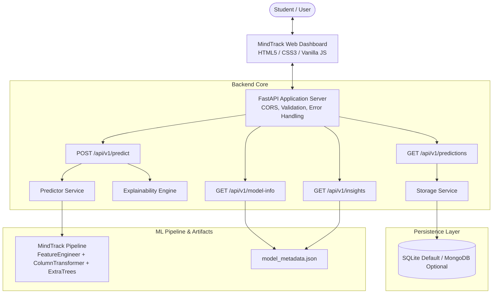

# 🧠 MindTrack — Mental Health Score Prediction & Digital Wellbeing Insights

> **An end-to-end production Machine Learning service and web application predicting individual digital wellbeing scores (0–10) from screen time, sleep patterns, physical movement, and stress indicators with local & global explainability.**

[](https://www.python.org/)
[](https://fastapi.tiangolo.com/)
[](https://scikit-learn.org/)
[](https://pydantic.dev/)
[](https://docs.pytest.org/)
[](LICENSE)

---

## Table of Contents

1. [Project Overview](#project-overview)
2. [Problem Statement](#problem-statement)
3. [Features](#features)
4. [Tech Stack](#tech-stack)
5. [Dataset](#dataset)
6. [Machine Learning Approach](#machine-learning-approach)
7. [Models Compared](#models-compared)
8. [Actual Evaluation Metrics](#actual-evaluation-metrics)
9. [Project Architecture](#project-architecture)
10. [API Endpoints](#api-endpoints)
11. [Installation](#installation)
12. [How to Run](#how-to-run)
13. [Testing](#testing)
14. [Screenshots](#screenshots)
15. [Limitations](#limitations)
16. [Responsible Use](#responsible-use)
17. [Future Improvements](#future-improvements)

---

## Project Overview

**MindTrack** is a full-stack Machine Learning application designed to quantify, analyze, and explain the relationship between daily digital media habits and personal wellbeing.

While modern smartphones provide basic telemetry (daily screen time, unlocks, and sleep duration), these metrics are rarely synthesized into an interpretable wellbeing indicator. MindTrack bridges this gap by passing multivariate behavioral indicators through an ensemble learning pipeline to estimate a continuous **0–10 Wellbeing Score**, paired with directional feature attributions that explain *why* the score was given.

---

## Problem Statement

Excessive screen time, sleep displacement, and constant digital notifications are frequently correlated with elevated psychological strain among students and young adults. However, individual habits do not operate in isolation:
- High screen time combined with 8 hours of restorative sleep has a different impact than high screen time coupled with severe sleep deprivation.
- Frequent device unlocking (attention fragmentation) exerts distinct pressure compared to continuous passive consumption.

MindTrack formulates this challenge as a **continuous regression problem**, modeling non-linear feature interactions to estimate subjective mental health scores while maintaining strict interpretability, data privacy, and ethical guardrails.

---

## Features

- **Leak-Free ML Pipeline:** Built using scikit-learn `Pipeline` and `ColumnTransformer`, bundling domain-specific feature engineering, outlier clipping, missing-value imputation, standard scaling, and one-hot encoding.
- **Rigorous 5-Fold Cross-Validation:** Systematic benchmarking across 5 regression models with zero data leakage between training folds and test sets.
- **Champion Model:** Production `ExtraTreesRegressor` pipeline achieving $R^2 = 0.8552$ and $\text{RMSE} = 0.5085$ on a held-out test split of 1,000 samples.
- **Dual Explainability Engine:**
  - **Global:** Tree-based feature importance weights across the complete population.
  - **Local:** Real-time directional factor attribution cards comparing user habits against cohort baselines.
- **Tailored Lifestyle Recommendations:** Rule-informed suggestions targeting sleep recovery, digital boundaries, notification batching, and movement.
- **Production FastAPI Backend:** Modular architecture with Pydantic v2 schemas, strict type validation, descriptive error responses, and automated OpenAPI documentation (`/docs`).
- **Dual Persistence Layer:** Seamless MongoDB integration with automatic fallback to local SQLite (`backend/data/predictions.db`) for zero-configuration local execution.
- **Responsive Dashboard:** Modern UI featuring 4 instant-fill preset student profiles, live feature engineering preview, SVG score gauge, Chart.js analytics visualizations, model diagnostics, and prediction history.
- **Automated Test Suite:** 20 comprehensive `pytest` tests validating health checks, valid/invalid inputs, edge cases, model artifact loading, and pipeline transformations.
- **Ethical Guardrails:** Explicit non-diagnostic disclaimers and international crisis helpline resources embedded across both UI and API contracts.

---

## Tech Stack

| Layer | Technologies |
|---|---|
| **Machine Learning** | Python 3.10+, Scikit-Learn, Pandas, NumPy, SciPy, Joblib |
| **Backend & API** | FastAPI, Uvicorn (ASGI), Pydantic v2 |
| **Storage & Persistence** | SQLite (Default, WAL mode), PyMongo (Optional MongoDB support) |
| **Testing & Quality** | Pytest, AnyIO, Starlette TestClient |
| **Frontend Dashboard** | Vanilla HTML5, Modern CSS3 (Glassmorphism, CSS Grid, Custom Properties), Vanilla JavaScript (ES6+), Chart.js |
| **Data & Visualization** | Matplotlib, Seaborn (evaluation artifacts) |

---

## Dataset

The model is trained on a dataset of **4,998 unique student survey records** (2 exact duplicates removed from 5,000 raw samples) capturing academic routines, digital media engagement, and lifestyle habits:

| Feature | Type | Range / Values | Description |
|---|---|---|---|
| `Age` | Numerical | 18 – 25 years (Mean: 20.8) | Respondent's chronological age |
| `Gender` | Categorical | Female, Male | Self-reported gender |
| `Country` | Categorical | Top 10 + 'Other' | Country of residence (India, USA, Canada, UK, etc.) |
| `Academic_Level` | Categorical | High School, Undergraduate, Graduate | Current academic stage |
| `Most_Used_Platform` | Categorical | Instagram, TikTok, YouTube, etc. | Primary digital platform |
| `Purpose_Of_Use` | Categorical | Entertainment, Education, Networking, News | Primary motivation for usage |
| `Avg_Daily_Usage_Hours` | Numerical | 1.0 – 8.8 hrs (Mean: 5.08) | Daily hours spent on social media |
| `Daily_Unlocks` | Numerical | 62 – 273 unlocks (Mean: 171.5) | Frequency of device unlocks per day |
| `Study_Hours` | Numerical | 0.3 – 8.3 hrs (Mean: 3.01) | Daily academic / coursework hours |
| `Physical_Activity_Hours` | Numerical | 0.0 – 4.1 hrs (Mean: 1.75) | Daily physical movement / exercise hours |
| `Sleep_Hours_Per_Night` | Numerical | 3.6 – 9.9 hrs (Mean: 6.63) | Restorative sleep duration per night |
| `Stress_Level` | Ordinal | Low, Medium, High, Very High | Subjective self-assessed stress tier |
| **`Mental_Health_Score`** | **Target (Continuous)** | **3.6 – 9.4 (Mean: 6.23, Std: 1.28)** | Quantitative wellbeing score (0–10 scale) |

---

## Machine Learning Approach

### 1. Data Cleaning & Domain Safeguards
- **Duplicate Removal:** Removed 2 exact duplicates from the raw dataset.
- **Physical Activity Clipping:** Negative physical activity entries (e.g., `-0.4 hrs`) clipped to $0.0$.
- **Country Cardinality Grouping:** Infrequent countries outside the top 10 mapped to `'Other'` to prevent high-cardinality explosion.

### 2. Custom Feature Engineering (`FeatureEngineer`)
Domain-informed features engineered directly inside the Scikit-Learn pipeline:
- **Screen-to-Sleep Ratio:**
  $$\text{Screen\_to\_Sleep\_Ratio} = \frac{\text{Avg\_Daily\_Usage\_Hours}}{\text{Sleep\_Hours\_Per\_Night} + 0.1}$$
  *Measures digital consumption competing with restorative rest.*
- **Active-to-Sedentary Ratio:**
  $$\text{Active\_to\_Sedentary\_Ratio} = \frac{\text{Study\_Hours} + \text{Physical\_Activity\_Hours}}{\text{Avg\_Daily\_Usage\_Hours} + 0.5}$$
  *Measures lifestyle balance (constructive time vs. passive screen time).*
- **Unlocks Per Usage Hour:**
  $$\text{Unlocks\_Per\_Usage\_Hour} = \frac{\text{Daily\_Unlocks}}{\text{Avg\_Daily\_Usage\_Hours} + 0.2}$$
  *Quantifies attentional fragmentation and compulsive phone-checking.*

### 3. Preprocessing ColumnTransformer
- **Numerical Pipeline:** `SimpleImputer(strategy='median')` $\rightarrow$ `StandardScaler()`
- **Ordinal Pipeline:** `OrdinalEncoder(categories=[['Low', 'Medium', 'High', 'Very High']])`
- **Categorical Pipeline:** `SimpleImputer(strategy='most_frequent')` $\rightarrow$ `OneHotEncoder(handle_unknown='ignore', sparse_output=False)`

---

## Models Compared

5 candidate regression models were trained using **5-Fold Cross-Validation** on an 80% training split (3,998 samples) and evaluated on a held-out 20% test split (1,000 samples):

1. **Extra Trees Regressor** (Extremely Randomized Trees)
2. **Random Forest Regressor**
3. **Gradient Boosting Regressor**
4. **Ridge Regression** (L2 Regularized Linear Model)
5. **Linear Regression** (Ordinary Least Squares Baseline)

---

## Actual Evaluation Metrics

> **Note:** All metrics below are the actual numbers evaluated on the dataset and saved in `ml/artifacts/model_metadata.json` and `backend/app/models/model_metadata.json`.

### Benchmark Results Table

| Model | 5-Fold CV R² | 5-Fold CV RMSE | 5-Fold CV MAE | Test Set R² | Test Set RMSE | Test Set MAE | Test Set MSE | Status |
|---|---|---|---|---|---|---|---|---|
| **Extra Trees Regressor** | **0.8372** | **0.5100** | **0.3907** | **0.8552** | **0.5085** | **0.3875** | **0.2585** | **🏆 Champion** |
| Random Forest Regressor | 0.8280 | 0.5240 | 0.4056 | 0.8441 | 0.5276 | 0.4056 | 0.2784 | Candidate |
| Gradient Boosting Regressor | 0.8024 | 0.5616 | 0.4361 | 0.8216 | 0.5643 | 0.4401 | 0.3185 | Candidate |
| Ridge Regression | 0.7293 | 0.6571 | 0.5218 | 0.7454 | 0.6741 | 0.5328 | 0.4544 | Baseline |
| Linear Regression | 0.7293 | 0.6572 | 0.5218 | 0.7453 | 0.6743 | 0.5330 | 0.4547 | Baseline |

### Champion Model Selection Rationale
- **Extra Trees Regressor** achieved the lowest test error ($\text{MAE} = 0.3875$, $\text{RMSE} = 0.5085$) and highest explained variance ($R^2 = 0.8552$).
- Randomizing split thresholds reduces model variance and provides strong resilience against overfitting on tabular survey data.
- Hyperparameter regularization (`n_estimators=120`, `max_depth=14`, `min_samples_split=4`, `min_samples_leaf=2`, `max_features='sqrt'`) keeps the pipeline artifact compact at **3.1 MB**.

### Top Global Feature Importances
1. `Screen_to_Sleep_Ratio`: **16.69%**
2. `Avg_Daily_Usage_Hours`: **15.37%**
3. `Stress_Level`: **14.62%**
4. `Sleep_Hours_Per_Night`: **11.57%**
5. `Daily_Unlocks`: **10.46%**
6. `Active_to_Sedentary_Ratio`: **8.65%**
7. `Study_Hours`: **7.14%**
8. `Grouped_Country`: **3.40%**

---

## Project Architecture

### Pipeline Flow

```text
Student Lifestyle Survey Data (CSV)
             │
             ▼
 Data Cleaning & Cardinality Reduction (Top 10 + Other)
             │
             ▼
 Custom Feature Engineering (Screen-to-Sleep, Active-to-Sedentary, Unlocks/Hour)
             │
             ▼
 Preprocessing Pipeline (Median Imputation, Scaling, Ordinal & One-Hot Encoding)
             │
             ▼
 Trained Model Pipeline (ExtraTreesRegressor Artifact: mindtrack_pipeline.joblib)
             │
             ▼
 FastAPI Backend Service (Validation, Inference, Explainability, Recommendations)
             │
             ▼
 Modern Responsive Dashboard (Predictions, Local Factors, Chart.js Analytics, History)
```

### System Architecture Diagram



---

## API Endpoints

Base URL: `http://127.0.0.1:8000` | API Prefix: `/api/v1`

| Method | Endpoint | Description |
|---|---|---|
| `GET` | `/` | Welcome message, API version, and documentation links |
| `GET` | `/health` | Service health status, model loaded flag, and storage backend |
| `POST` | `/api/v1/predict` | Predicts mental health score with explainability factors |
| `GET` | `/api/v1/model-info` | Metadata, hyperparameters, and model comparison metrics |
| `GET` | `/api/v1/insights` | Cohort statistics, feature averages, and distribution data |
| `GET` | `/api/v1/predictions` | Retrieves stored prediction history |
| `DELETE` | `/api/v1/predictions/{id}` | Deletes a single prediction record by ID |
| `DELETE` | `/api/v1/predictions` | Clears all prediction records |

### Sample Request (`POST /api/v1/predict`)

```bash
curl -X POST http://127.0.0.1:8000/api/v1/predict \
  -H "Content-Type: application/json" \
  -d '{
    "age": 21,
    "gender": "Female",
    "country": "Canada",
    "academic_level": "Undergraduate",
    "most_used_platform": "Instagram",
    "purpose_of_use": "Entertainment",
    "avg_daily_usage_hours": 3.5,
    "daily_unlocks": 110,
    "study_hours": 4.5,
    "physical_activity_hours": 2.0,
    "sleep_hours_per_night": 7.8,
    "stress_level": "Medium"
  }'
```

### Sample Response

```json
{
  "predicted_mental_health_score": 7.09,
  "wellbeing_tier": "Balanced / Moderate Wellbeing",
  "tier_color": "#06b6d4",
  "interpretation": "Your lifestyle indicators are generally healthy with minor areas where digital boundaries or recovery sleep could offer noticeable boosts.",
  "contributing_factors": [
    {
      "factor": "Focused Attention (Low Unlocks)",
      "impact": "positive",
      "description": "Only 110 daily unlocks reflects uninterrupted focus and intentional device interaction.",
      "weight_score": 0.35
    },
    {
      "factor": "Restrained Screen Time",
      "impact": "positive",
      "description": "Controlled screen use of 3.5h (1.6h below average) protects mental bandwidth.",
      "weight_score": 0.32
    },
    {
      "factor": "Restorative Sleep Schedule",
      "impact": "positive",
      "description": "Sufficient sleep (7.8h/night) acts as a strong buffer against cognitive fatigue and mood dips.",
      "weight_score": 0.29
    }
  ],
  "recommendations": [
    "Maintain your current restorative sleep routine—consistent recovery is your primary resilience buffer."
  ],
  "model_used": "Extra Trees",
  "prediction_id": "312ff424-cc17-4486-baff-6a5c61ce9cc5",
  "timestamp": "2026-10-06T17:35:23.234301+00:00",
  "disclaimer": "MindTrack is an educational and informational tool powered by machine learning..."
}
```

---

## Installation

### Prerequisites
- Python 3.10+ (tested on Python 3.10, 3.11, 3.12, 3.14)
- Git

### Setup Steps

```bash
# 1. Clone the repository
git clone https://github.com/your-username/mental-health-score-prediction.git
cd mental-health-score-prediction

# 2. Create and activate a virtual environment
python3 -m venv venv
source venv/bin/activate       # On macOS/Linux
# venv\Scripts\activate        # On Windows

# 3. Install dependencies
pip install -r requirements.txt
```

---

## How to Run

### Start the Application

```bash
python -m uvicorn main:app --reload --host 127.0.0.1 --port 8000
```

### Access Application Interfaces
- **Web Dashboard:** [http://127.0.0.1:8000/app/](http://127.0.0.1:8000/app/)
- **Interactive Swagger Docs:** [http://127.0.0.1:8000/docs](http://127.0.0.1:8000/docs)
- **ReDoc Documentation:** [http://127.0.0.1:8000/redoc](http://127.0.0.1:8000/redoc)
- **Health Endpoint:** [http://127.0.0.1:8000/health](http://127.0.0.1:8000/health)

### (Optional) Model Training & Evaluation

To reproduce model training, cross-validation, and generate evaluation plots from scratch:

```bash
# Run training pipeline (saves model artifact to ml/artifacts/ and backend/app/models/)
python ml/src/train.py

# Run standalone evaluation suite
python ml/src/evaluate.py
```

---

## Testing

MindTrack includes an automated test suite executed with `pytest`:

```bash
# Run the entire test suite
pytest -v

# Run ML pipeline & robustness tests specifically
pytest backend/tests/test_ml_pipeline.py -v
```

### Test Coverage Highlights
- **Health & Root Endpoints:** Status, model loading confirmation, storage type.
- **Prediction Flow:** Valid payload prediction, score range bounding ($1.0 \le \text{score} \le 10.0$), wellbeing tiers.
- **Request Validation:** Invalid ages, out-of-range hours, unrecognized stress levels, missing required fields.
- **Pipeline Robustness:** Missing-value handling via median/mode imputation, negative activity clipping, unseen country grouping, directional sensitivity (healthy vs. high-strain profile).
- **History & Persistence:** CRUD operations against local SQLite storage.

---

## Screenshots

Evaluation charts are saved directly in `ml/artifacts/plots/`:

| Visualization | Description |
|---|---|
| `ml/artifacts/plots/model_comparison.png` | 5-fold CV vs. Test Set $R^2$ and RMSE comparison across all 5 algorithms |
| `ml/artifacts/plots/actual_vs_predicted.png` | Scatter plot with ideal fit line on 1,000 held-out test predictions |
| `ml/artifacts/plots/residuals_distribution.png` | Residual error distribution centered around zero with Gaussian fit |
| `ml/artifacts/plots/feature_importance.png` | Ranked tree-based feature importance weights for all features |

---

## Limitations

1. **Survey-Based Self-Reporting:** Data reflects self-reported approximations of daily screen time, sleep, and physical activity rather than automated hardware telemetry.
2. **Target Demographics:** The underlying training dataset is focused primarily on students and young adults (aged 18–25). Generalization to other age groups should be interpreted cautiously.
3. **Correlation vs. Causation:** The regression model identifies statistical relationships. High screen time may be a coping mechanism for pre-existing stress rather than the direct causal factor.
4. **Static Feature Weights:** Feature importance represents global and linear cohort offsets; individual neurodivergent or shift-worker routines may not align with standard student baseline averages.

---

## Responsible Use

> [!IMPORTANT]
> **MindTrack is strictly an educational, statistical machine learning tool. It is NOT a clinical diagnostic device, medical software, or psychiatric assessment tool.**
>
> It does not diagnose clinical depression, anxiety, or any medical condition. Predicted scores represent statistical lifestyle estimates based on survey responses.
>
> If you or someone you know is experiencing psychological distress or a mental health crisis:
> - **United States & Canada:** Call or text **988** (Suicide & Crisis Lifeline, 24/7 free & confidential)
> - **Crisis Text Line:** Text **HOME** to **741741**
> - **United Kingdom:** Call **111** (NHS) or **116 123** (Samaritans)
> - **India:** Call **14416** (Tele-MANAS, 24/7 mental health helpline)
> - **International Helplines:** Visit [findahelpline.com](https://findahelpline.com) or [befrienders.org](https://www.befrienders.org)

---

## Future Improvements

- [ ] **Interactive SHAP Waterfall Plots:** Client-side tree explainer waterfall charts visualizing exact Shapley value additions for individual check-ins.
- [ ] **Time-Series Tracking:** Longitudinal check-in timeline allowing users to visualize wellbeing trends and lifestyle shifts across weeks.
- [ ] **Automated OS Telemetry:** Optional Apple Screen Time / Android Digital Wellbeing API integrations for automated, objective metric logging.
- [ ] **Counterfactual Goal Simulator:** Interactive "what-if" simulator estimating score changes from target habits (e.g., *"What if I sleep 1 hour more and reduce screen time by 1.5h?"*).

---

## License

This project is licensed under the [MIT License](LICENSE).
